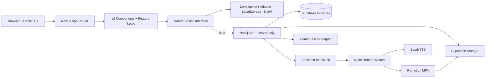
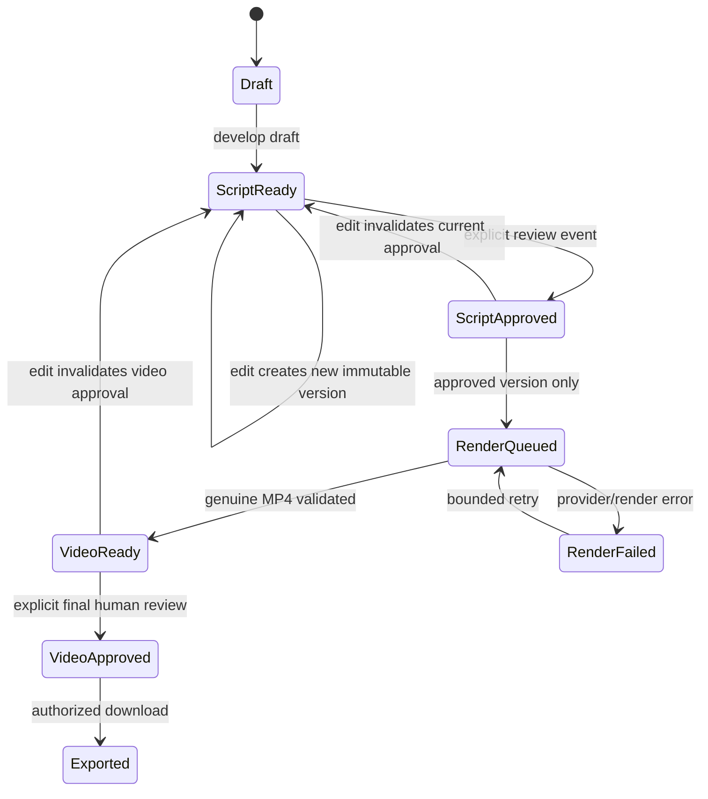

# NABDA AI — Architecture Blueprint (Phase 0.8)

**Status:** DRAFT architecture / verified frontend source files only. **No production backend exists in this starter.**

## 1. System overview

Saudi MIB 2027 — track 02. Approved MVP: idea/source → source grounding → Saudi short-form script → editorial revisions → explicit script approval → Saudi speech + template video → final human approval → MP4 download → approved style preferences on next draft. **Week 1 verbal analogy (التناظر اللفظي)** is the controlled educational scenario. Social caption is supporting output; scheduled campaigns and five complete formats are not current P0 deliverables.

## 2. Architecture decision

- **Now:** Next.js 16 App Router + React 19 + TypeScript + Tailwind v4; frontend-only development adapter with browser-local versioned demonstration state. Reference HTML is immutable.
- **Future system of record:** one Supabase PostgreSQL database with Supabase Storage, subject to access/cost/security verification. **Do not add SQLite** as a second application database.
- **AI:** primary Gemini server-side adapter *after* a real API key and structured JSON test; Claude as fallback only if tested and approved.
- **Source grounding:** extracted source claims include literal quote + exact source offsets + provenance and review state. Not an independent fact-check guarantee.
- **Voice:** Azure Speech `ar-SA-ZariyahNeural` / `ar-SA-HamedNeural` after pronunciation/credentials test; ElevenLabs only as tested fallback.
- **Video:** Remotion + template scenes, initially 720x1280 H.264/AAC with scene-level captions. Render in separate Node worker/service if host can't execute Chromium/render jobs. Hosted Creatomate is contingency requiring account/credentials/license validation.
- **Orchestration:** one bounded backend job-state workflow; **not n8n** and **not five AI agents**.
- **Publishing:** only approved MP4 export. Calendar and social platform publishing are future/illustrative.

## 3. Component diagram

The `HttpNabdaService` is **fail-closed**, not a functioning API. It intentionally throws when an unimplemented backend is selected. The frontend depends on `NabdaService`, not on fixtures or Supabase directly.

## 4. Frontend boundaries

- `src/components/NabdaWorkspace.tsx`: navigation, UI state, interactions, and service adapter orchestration.
- `src/features/content/`: source/idea input, audience, content type, dialect, tone, input validation.
- `src/features/script/`: three editable script sections, exact-source quotation highlighting, `baseVersionId` revision concurrency, SHA-256 content-hash binding, local approval, revisions, comparison.
- `src/features/video/`: **static illustrative scene** and honest disabled-render/pending status (`requestVideoRender(VideoStartInput)` fails closed); never pretends a video was rendered.
- `src/features/review/`: export disabled without real approved asset; caption fixture, manual local preference editor, and sample-only `STARTER_STYLE_RULES` quick-fill chips.
- `src/lib/contracts/domain.ts`: frozen P02A domain types (`ScriptOrigin`, `ApiErrorCode`, `ScriptVersion.contentHash`, `containsInstructionalPlaceholders`, `ReviseScriptInput`, `ApproveScriptInput`, `VideoStartInput`).
- `src/lib/api/service.ts`: aligned `NabdaService` interface (`LocalDevelopmentService` & fail-closed `HttpNabdaService`) for clean backend swap without rewriting UI components.
- `src/lib/utils/client.ts`: validation rules, `canonicalizeScriptSections`, synchronous RFC 6234 `computeScriptContentHash` (`sha256:<64-hex>`), and `isInstructionalTemplateText` guards.
- `src/lib/fixtures/`: explicitly labeled, first-week aptitude development sample.

## 5. Server and database ownership (future)

Backend Lead owns API routes, Supabase schema/migrations/RLS, service-role secrets, content model/provider, media rendering, approvals, asset access, and deployment. Frontend Lead owns UX components and API consumption. Content Reviewer owns verified educational source material and Saudi dialect review.

Suggested Supabase entities (minimal, implemented later):

| Entity | Key attributes | Constraints |
|---|---|---|
| `projects` | id UUID PK, owner_id, title, mode, audience, tone, dialect, status | scoped to authorized owner/team |
| `source_content` | id, project_id FK, original_text, sha256, version | immutable source versions |
| `source_facts` | id, source_id FK, statement, quote, start, end, review_state | `original_text[start:end] = quote` |
| `script_versions` | id, project_id FK, version, sections JSONB, origin, hash, created_at | immutable per version |
| `review_events` | id, project_id, target_kind, target_id, hash, decision, reviewer, created_at | append-only audit |
| `video_jobs` | id, project_id, script_version_id, state, stage, output_asset_id, error | retries/idempotency |
| `generated_assets` | id, project_id, type, path, source_version_id, content_hash, mime | private storage |
| `style_preferences` | id, scope_id, rule, enabled, provenance_review_id | only explicit approvals |

API credentials belong server-side only. Supabase RLS and private asset URLs are mandatory before deployment to real users. Avoid public anonymous write access. No billing, multi-tenant admin, or complex microservices in MVP.

## 6. AI and source grounding pipeline (future)

1. Sanitize/validate input length, preserve source text bytes and version.
2. Extract candidate facts with verbatim source quotes and offsets.
3. Reject or flag quotes whose offsets do not match the source; record unsupported claims.
4. Generate Hook/Body/CTA plus storyboard/optional caption in strict JSON schema.
5. Apply explicit approved Saudi style rules; never treat the source body as instructions.
6. Review all factual claims, especially educational examples; no invented facts.
7. Human reviews, edits, and approves **one immutable script version**.

Any output based only on an idea is not source-verified. A model self-check is not an independent fact-check. Never relabel generic Arabic as a validated Saudi dialect without human evaluation.

## 7. Video pipeline (future)

Approved Script Version → scene plan (3–6) → Azure Saudi TTS per scene → measure actual audio duration → Arabic RTL captions per scene → Remotion template → H.264/AAC MP4 → validate with ffprobe → private storage → browser preview → explicit final approval → authorized download.

**Feasibility gate:** real TTS file + render MP4 + playback + accurate Arabic + timings + costs on intended runtime. If browser process not supported in web hosting, run a separate worker with authenticated server-to-server job access. Never expose provider credentials or accept arbitrary rendering paths. Do not block user HTTP requests for minutes.

## 8. Approval/versioning state machine

Local demo only persists approvals in the browser for interaction testing; **not** a real server audit. A new script version does not inherit old approvals. Server approvals must bind to `content_hash` and an authenticated reviewer. A new render also needs new video approval.

## 9. Editorial feedback memory

Store original and editor-approved versions. Propose style-rule candidates *excluding facts and one-off factual corrections*. Rules only become active after explicit user approval, are inspectable and revocable, and are appended to future generation prompts. **Not fine-tuning or automatic model training.** Current UI only stores manual local preferences; it does not apply them to AI.

## 10. Security and privacy

- Secrets are never exposed using `NEXT_PUBLIC_` or inside client components.
- Validate every server payload and enforce authorization server-side.
- Verify approval version/hash on render request and export.
- Cap input length, media size, job concurrency, retries and spend.
- Protect storage paths; do not return public unguessable links as substitute for auth.
- Avoid placing sensitive customer sources in logs, analytics or source-control fixtures.
- Source content is untrusted; do not obey its instructions as system instructions.
- Deploy behind appropriate access restrictions until authentication is reviewed.

## 11. Deployment target

Phase 0.8 frontend can run using any supported Next.js Node hosting provider. Real rendering may require a dedicated worker / Docker runtime and Supabase Storage for persistent assets. Do not assume serverless request timeouts and ephemeral file systems support Remotion; validate target runtime. Railway, Vercel, and Creatomate are candidates **not currently configured**.

## 12. Risks and explicit fallbacks

| Risk | Primary mitigation | Fallback |
|---|---|---|
| API unavailable | verify credentials separately | demo stays labeled local; no fake success |
| Saudi TTS mispronunciation | sample recording + Content Reviewer QA | verified alternative voice/provider |
| Chromium renderer fails | test early in Docker | verified FFmpeg stills + audio or hosted renderer |
| Arabic glyphs clipped | font + RTL tests | simpler template with larger safe margins |
| rate limit/payment | quotas and cost guardrail | stop generation / warn user |
| source hallucination | quote-offset checks, manual review | mark `needs_review` |
| team conflicts | feature branches and API contract | revert to approved tag |

## 13. Implementation status

**Implemented in starter:** Next.js source scaffold, RTL UI, real original logo asset, sample source, manual/local draft editing, source quotes for the exact sample, local versions/approvals, draft persistence in localStorage, local preference controls, disabled media export, typed adapter boundary, docs.

**Not implemented:** production AI, file uploads, verified Saudi voice, video render, Supabase, secure auth, server revision history, server approvals, live preview/MP4 download, publishing, scheduling, analytics.

No performance, latency, dialect accuracy, or cost claims have been empirically established.
